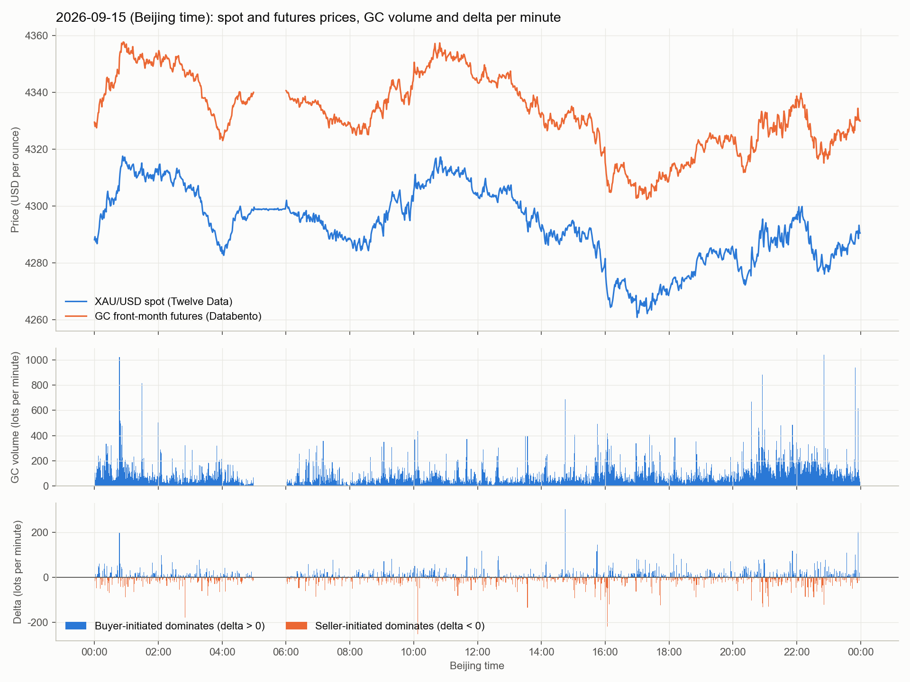
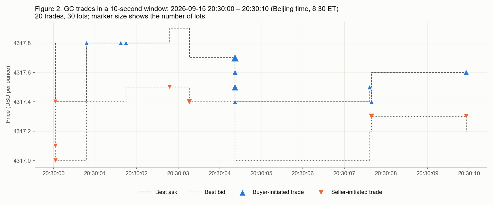

English version of `数据说明/数据说明.md`.

# 1. Data overview

| ID | Dataset | Source | Download date | Time range (Beijing time) | File size | Status |
|---|---|---|---|---|---|---|
| D1 | XAU/USD spot 1-minute bars | Twelve Data API | 2026-09-27 | 2025-09-29 05:55 – 2026-09-28 13:27 | 30.2 MB (CSV) | Completed |
| D2 | XAU/USD spot 1-minute bars + quote volume | Dukascopy historical data feed | 2026-10-24 | 2025-09-28 – 2025-11-08 (6 weeks only) | 1.2 MB (bi5 cache) | Aborted, not used |
| D3 | GC front-month futures 1-minute bars (OHLCV-1m) | Databento (CME Globex) | 2026-10-24 | 2025-09-29 06:00 – 2026-09-29 07:59 | 6.2 MB (DBN) / 19.5 MB (CSV) | Completed |
| D4 | GC front-month futures top-of-book + tick-by-tick trades (MBP-1) | Databento (CME Globex) | 2026-10-24 (job ID GLBX-20261025-PT9C6P3YKJ) | Same as above | 10.1 GB compressed (42.71 GB uncompressed) | Completed |
| D5 | Processed order flow and merged files | Computed from D1 and D4 | 2026-10-24 (Delta corrected 2026-10-25) | Same as D1 | About 430 MB in total | Completed |

# 2. Dataset details

## D1　XAU/USD spot 1-minute bars (Twelve Data)

- **Source**: Twelve Data, `time_series` endpoint, symbol `XAU/USD`, `interval=1min`, `timezone=Asia/Shanghai`.
- **Version**: Twelve Data REST API (no version number), free account. 5,000 bars per request, paging backwards by `end_date`, about 100 requests in total.
- **Download date**: 2026-09-27.
- **Licence**: Twelve Data Terms of Service. Data are for "internal use" only; **data from a free account may not be used for commercial purposes**, and may not be resold, redistributed or publicly displayed without authorisation; data are provided "as is". [1]
- **Size**: 500,874 rows, 30.2 MB.
- **Type**: time series, tabular numerical data.
- **Original format**: the API returns JSON (each bar as string fields); the script saves it as CSV.
- **Fields**: `datetime, open, high, low, close`, **no volume** (spot is an OTC market with no centralised volume).
- **Example**:

```
datetime,open,high,low,close
2025-09-29 05:55:00,3770,3770,3770,3770
2025-09-29 05:56:00,3770,3770,3769.9,3769.9
```

- **Quality**: no gaps longer than 3 hours on weekdays; 1,659 flat bars (open, high, low and close equal), mostly in thin trading periods.

## D2　Dukascopy spot data (aborted, not used)

- **Source**: Dukascopy Bank public historical data feed `datafeed.dukascopy.com`, `XAUUSD/{year}/{month-1}/{day}/BID_candles_min_1.bi5` and `ASK_...`.
- **Download date**: 2026-10-24. The server kept rate-limiting (HTTP 429); download stopped after only 84 daily files.
- **Licence**: Dukascopy publishes no explicit data licence. Its download tool states "personal use", at the user's own risk. [2]
- **Original format**: LZMA-compressed binary, 24 bytes per record, big-endian: time offset (seconds), open, close, low, high (integers, ÷1000 gives the price), volume (float).
- **Example** (first record of 2025-10-01):

```
Hex:     00 00 00 00 00 3a f0 f7 00 3a f2 73 00 3a ee e5 00 3a f2 a5 3c fb e7 6d
Decoded: time +0 s, open 3862.775, close 3863.155, low 3862.245, high 3863.205, volume 0.03075
```

- **Note**: its volume is only the quoted order volume on Dukascopy's own platform, not market traded volume. Because we switched to CME futures data, this dataset was not included in the analysis.

## D3　GC front-month futures 1-minute bars (Databento OHLCV-1m)

- **Source**: Databento, dataset `GLBX.MDP3` (CME Globex MDP 3.0 market data), symbol `GC.v.0` (the GC contract ranked first by volume, i.e. the front-month continuous contract), schema `ohlcv-1m`.
- **Version**: DBN encoding, `databento` Python library 0.88.0.
- **Download date**: 2026-10-24.
- **Cost**: $1.28 (covered by Databento's $125 new-user free credit).
- **Licence**: Databento usage-based billing account; the underlying data are CME Group market data, governed by the CME Information License Agreement (ILA), for personal internal use, **no redistribution**. External distribution requires separate authorisation. [3][4]
- **Size**: 350,611 rows (only minutes with trades); original `.dbn.zst` 6.2 MB, CSV 19.5 MB.
- **Type**: time series, tabular numerical data.
- **Original format**: DBN (Databento Binary Encoding) + zstd compression, converted to CSV, times converted to Beijing time.
- **Example**:

```
datetime,symbol,open,high,low,close,volume
2025-09-29 06:00:00,GC.v.0,3788.8,3791.5,3785.5,3790.8,539
2025-09-29 06:01:00,GC.v.0,3790.9,3795.2,3790.2,3793.2,271
```

- **Quality**: Databento marks a few dates as "degraded", e.g. 2025-11-28, 2026-01-31, 2026-03-15; see `condition.json`.

## D4　GC front-month futures MBP-1 (top of book + tick-by-tick trades)

- **Source**: Databento `GLBX.MDP3`, symbol `GC.v.0`, schema `mbp-1`, batch job split into monthly files.
- **Version**: DBN version 3, zstd compression; job metadata in `metadata.json`, file checksums in `manifest.json` (SHA-256).
- **Download date**: 2026-10-24 (job ID `GLBX-20261025-PT9C6P3YKJ`, numbered by UTC date).
- **Cost**: $71.60 (covered by the free credit).
- **Licence**: same as D3.
- **Size**: 13 monthly files, 10.1 GB compressed, billed size (uncompressed) 42.71 GB; 29.32 million trades in total and several hundred million order-book events.
- **Type**: event stream (tick level); each record is one order-book change or one trade, with nanosecond timestamps.
- **Original format**: DBN binary, 80 bytes per record, prices as integers (×10⁻⁹).
- **Fields**: `ts_event`, `action` (A add / C cancel / M modify / T trade / F fill), `side` (for trades, the aggressor side: B buyer-initiated, A seller-initiated, N undetermined), `price`, `size` (contracts, 1 contract = 100 oz), `bid_px_00`, `ask_px_00`, `bid_sz_00`, `ask_sz_00`, `bid_ct_00`, `ask_ct_00`, etc.
- **Example** (first record in the file, UTC time):

```
Mbp1Msg(ts_event=2025-09-28T12:00:06.203970449Z, instrument_id=39231,
        action='A', side='N', price=3805, size=2,
        bid_px_00=3789.5, ask_px_00=3790.2, bid_sz_00=3, ask_sz_00=1)
```

## D5　Processed data (computed from D1 and D4)

| File | Rows | Size | Content |
|---|---|---|---|
| `GC_processed/trades/*.parquet` | 29,326,766 | 334 MB | Tick-by-tick trades: price, contracts, aggressor side, best bid / best ask prices and sizes at the time of the trade |
| `GC_processed/GC_1min_orderflow.csv` | 350,611 | 30 MB | GC per minute: open, high, low, close, volume, buyer-initiated volume, seller-initiated volume, Delta, intraday cumulative Delta, number of trades |
| `GC_processed/XAUUSD_spot_with_GC_orderflow.csv` | 500,874 | 65 MB | Based on the D1 spot minutes, merged with GC order flow and the basis `basis = GC close − spot close` |

- **Reconciliation**: total volume aggregated from MBP-1 is 42,074,743 contracts, exactly matching D3, with zero difference minute by minute; the aggressor side can be determined for 97.2% of volume.
- **Correction log**: in the first processing run the `size` field was an unsigned integer, so Delta overflowed when negative. On 2026-10-25 it was changed to int64, Delta and cumulative Delta were recomputed, and the processing script was fixed accordingly.
- **Basis statistics**: median $16.2, mean $19.2. In minutes with violent price moves extreme values occur (−164 to +100), because the two sources take the close at different instants; hourly or daily medians are recommended.

# 3. Data examples

## Figure 1　Price, volume and Delta for one day (2026-09-15)

Top: per-minute close of spot (D1) and GC futures (D3/D4); the distance between the two lines is the basis (about $40). Middle: GC per-minute volume; 05:00–06:00 Beijing time is the CME daily halt. Bottom: per-minute Delta; blue = buyer-initiated volume dominates, orange = seller-initiated volume dominates.

 (Chinese: `数据说明/图1_一天的价格_成交量_Delta.png`)

## Figure 2　Ten-second tick-by-tick trade snippet (2026-09-15 20:30:00–20:30:10)

Tick-by-tick trades over 10 seconds at 8:30 ET (when economic data are often released): 20 trades, 30 contracts. Dashed lines are the best ask and best bid; ▲ = buyer-initiated (traded at the best ask), ▼ = seller-initiated (traded at the best bid). Raw data in `示例_10秒逐笔成交_20260915_203000.csv`.

 (Chinese: `数据说明/图2_10秒逐笔成交片段.png`)

# 4. File locations

- Raw and processed data: `~/Desktop/project/` (`XAUUSD_1min_1year.csv`, `GC_1min_1year.csv`, `GC_ohlcv1m_1year.dbn.zst`, `GC_mbp1/`, `GC_processed/`, `dukascopy_cache/`)
- Download and processing scripts: `~/Desktop/project/scripts/` (another copy in `~/Downloads/读书/黄金大师课/美股/`) (`fetch_xauusd.py`, `fetch_dukascopy_xauusd.py`, `databento_gc_cost.py`, `databento_gc_ohlcv1m.py`, `databento_gc_mbp1.py`, `process_gc_mbp1.py`, `fix_gc_delta.py`, `validate_gc_orderflow.py`, `make_data_examples.py`)

# References

1. Twelve Data Terms of Service: <https://twelvedata.com/terms>
2. Dukascopy Historical Data Feed: <https://www.dukascopy.com/swiss/english/marketwatch/historical/>
3. Databento pricing and licensing: <https://databento.com/pricing>; <https://databento.com/docs/faqs/usage-pricing-and-data-credits>
4. CME Group market data licensing policy: <https://www.cmegroup.com/market-data/license-data/market-data-policy-education-center.html>
