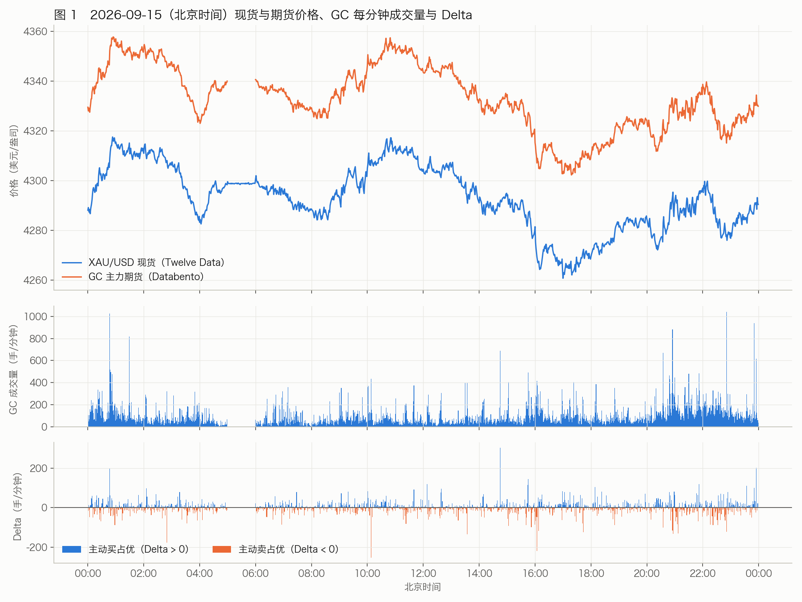
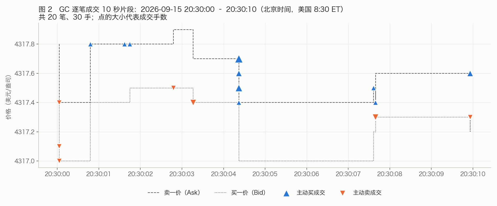

# 一、数据总览

| 编号 | 数据集 | 来源 | 下载日期 | 时间范围（北京时间） | 文件大小 | 状态 |
|---|---|---|---|---|---|---|
| D1 | XAU/USD 现货 1 分钟 K 线 | Twelve Data API | 2026-09-27 | 2025-09-29 05:55 – 2026-09-28 13:27 | 30.2 MB（CSV） | 已完成 |
| D2 | XAU/USD 现货 1 分钟 K 线 + 报价量 | Dukascopy 历史数据源 | 2026-10-24 | 2025-09-28 – 2025-11-08（仅 6 周） | 1.2 MB（bi5 缓存） | 已中止，未使用 |
| D3 | GC 主力期货 1 分钟 K 线（OHLCV-1m） | Databento（CME Globex） | 2026-10-24 | 2025-09-29 06:00 – 2026-09-29 07:59 | 6.2 MB（DBN）/ 19.5 MB（CSV） | 已完成 |
| D4 | GC 主力期货第一档盘口 + 逐笔成交（MBP-1） | Databento（CME Globex） | 2026-10-24（任务号 GLBX-20261025-PT9C6P3YKJ） | 同上 | 10.1 GB 压缩（解压后 42.71 GB） | 已完成 |
| D5 | 处理后的订单流与合并文件 | 由 D1、D4 计算得出 | 2026-10-24（2026-10-25 修正 Delta） | 同 D1 | 共约 430 MB | 已完成 |

# 二、各数据集详细说明

## D1　XAU/USD 现货 1 分钟 K 线（Twelve Data）

- **来源**：Twelve Data，`time_series` 接口，代码 `XAU/USD`，`interval=1min`，`timezone=Asia/Shanghai`。
- **版本**：Twelve Data REST API（无版本号），免费账户。每次请求 5,000 根，按 `end_date` 向前翻页，共约 100 次请求。
- **下载日期**：2026-09-27。
- **许可**：Twelve Data 服务条款。数据仅限「内部使用」，**免费账户的数据不得用于商业目的**，未经授权不得转售、再分发或对外展示；数据按「现状」提供。[1]
- **大小**：500,874 行，30.2 MB。
- **类型**：时间序列，表格数值数据。
- **原始格式**：API 返回 JSON（每根 K 线为字符串字段），脚本转存为 CSV。
- **字段**：`datetime, open, high, low, close`，**没有成交量**（现货是场外市场，没有集中成交量）。
- **示例**：

```
datetime,open,high,low,close
2025-09-29 05:55:00,3770,3770,3770,3770
2025-09-29 05:56:00,3770,3770,3769.9,3769.9
```

- **质量**：工作日没有超过 3 小时的断档；有 1,659 根平线（开高低收相同），多出现在成交清淡时段。

## D2　Dukascopy 现货数据（已中止，未使用）

- **来源**：Dukascopy Bank 公开历史数据源 `datafeed.dukascopy.com`，`XAUUSD/{年}/{月-1}/{日}/BID_candles_min_1.bi5` 与 `ASK_...`。
- **下载日期**：2026-10-24。服务器持续限流（HTTP 429），只下到 84 个日文件后停止。
- **许可**：Dukascopy 没有公开明确的数据许可条款。其下载工具提示「个人使用」，使用风险自负。[2]
- **原始格式**：LZMA 压缩的二进制，每条记录 24 字节、大端序：时间偏移（秒）、开、收、低、高（整数，÷1000 得价格）、成交量（浮点）。
- **示例**（2025-10-01 第一条记录）：

```
十六进制：00 00 00 00 00 3a f0 f7 00 3a f2 73 00 3a ee e5 00 3a f2 a5 3c fb e7 6d
解码：    时间 +0 秒, 开 3862.775, 收 3863.155, 低 3862.245, 高 3863.205, 量 0.03075
```

- **说明**：其成交量只是 Dukascopy 自家平台的报价挂单量，不是市场成交量。因改用 CME 期货数据，此数据集未纳入分析。

## D3　GC 主力期货 1 分钟 K 线（Databento OHLCV-1m）

- **来源**：Databento，数据集 `GLBX.MDP3`（CME Globex MDP 3.0 行情），代码 `GC.v.0`（按成交量排名第一的 GC 合约，即主力连续合约），schema `ohlcv-1m`。
- **版本**：DBN 编码，`databento` Python 库 0.88.0。
- **下载日期**：2026-10-24。
- **费用**：$1.28（由 Databento 新用户 $125 免费额度抵扣）。
- **许可**：Databento 按用量计费账户；底层数据为 CME Group 行情，受 CME 信息许可协议（ILA）约束，个人内部使用，**不得再分发**。对外分发需另行取得授权。[3][4]
- **大小**：350,611 行（仅含有成交的分钟）；原始 `.dbn.zst` 6.2 MB，CSV 19.5 MB。
- **类型**：时间序列，表格数值数据。
- **原始格式**：DBN（Databento Binary Encoding）+ zstd 压缩，已转为 CSV，时间转为北京时间。
- **示例**：

```
datetime,symbol,open,high,low,close,volume
2025-09-29 06:00:00,GC.v.0,3788.8,3791.5,3785.5,3790.8,539
2025-09-29 06:01:00,GC.v.0,3790.9,3795.2,3790.2,3793.2,271
```

- **质量**：Databento 将少数日期标记为「质量下降（degraded）」，例如 2025-11-28、2026-01-31、2026-03-15，详见 `condition.json`。

## D4　GC 主力期货 MBP-1（第一档盘口 + 逐笔成交）

- **来源**：Databento `GLBX.MDP3`，代码 `GC.v.0`，schema `mbp-1`，批量任务按月分文件。
- **版本**：DBN 第 3 版，zstd 压缩；任务元数据见 `metadata.json`，文件校验和见 `manifest.json`（SHA-256）。
- **下载日期**：2026-10-24（任务号 `GLBX-20261025-PT9C6P3YKJ`，按 UTC 日期编号）。
- **费用**：$71.60（由免费额度抵扣）。
- **许可**：同 D3。
- **大小**：13 个月度文件，压缩后 10.1 GB，计费大小（解压后）42.71 GB；共 2,932 万笔成交，数亿条盘口事件。
- **类型**：事件流（tick 级），每条记录是一个盘口变动或一笔成交，时间戳精确到纳秒。
- **原始格式**：DBN 二进制，每条记录 80 字节，价格为整数（×10⁻⁹）。
- **字段**：`ts_event`、`action`（A 挂单 / C 撤单 / M 改单 / T 成交 / F 成交回报）、`side`（成交时为主动方：B 主动买、A 主动卖、N 无法判断）、`price`、`size`（手，1 手 = 100 盎司）、`bid_px_00`、`ask_px_00`、`bid_sz_00`、`ask_sz_00`、`bid_ct_00`、`ask_ct_00` 等。
- **示例**（文件中第一条记录，UTC 时间）：

```
Mbp1Msg(ts_event=2025-09-28T12:00:06.203970449Z, instrument_id=39231,
        action='A', side='N', price=3805, size=2,
        bid_px_00=3789.5, ask_px_00=3790.2, bid_sz_00=3, ask_sz_00=1)
```

## D5　处理后的数据（由 D1、D4 计算）

| 文件 | 行数 | 大小 | 内容 |
|---|---|---|---|
| `GC_processed/trades/*.parquet` | 29,326,766 | 334 MB | 逐笔成交：价格、手数、主动方、成交时买一卖一价格与挂单量 |
| `GC_processed/GC_1min_orderflow.csv` | 350,611 | 30 MB | GC 每分钟：开高低收、成交量、主动买量、主动卖量、Delta、当日累计 Delta、成交笔数 |
| `GC_processed/XAUUSD_spot_with_GC_orderflow.csv` | 500,874 | 65 MB | 以 D1 现货每分钟为准，合并 GC 订单流与价差 `basis = GC 收盘价 − 现货收盘价` |

- **核对**：由 MBP-1 汇总的总成交量为 42,074,743 手，与 D3 完全一致，逐分钟零差异；97.2% 的成交量可判断主动方向。
- **修正记录**：首版处理时，`size` 字段为无符号整数，Delta 为负时发生溢出。已于 2026-10-25 改为 int64 重新计算 Delta 与累计 Delta，处理脚本同步修复。
- **价差统计**：中位数 16.2 美元，平均 19.2 美元。剧烈行情的分钟内会出现极端值（−164 至 +100），原因是两个数据源取收盘价的瞬间不同，建议用小时或日中位数。

# 三、数据示例

## 图 1　一天的价格、成交量与 Delta（2026-09-15）

上图：现货（D1）与 GC 期货（D3/D4）每分钟收盘价，两条线的距离就是价差（约 40 美元）。中图：GC 每分钟成交量；北京时间 05:00–06:00 为 CME 每日休市。下图：每分钟 Delta，蓝色为主动买占优，橙色为主动卖占优。



## 图 2　十秒逐笔成交片段（2026-09-15 20:30:00–20:30:10）

美国东部时间 8:30（经济数据常在此时公布）的 10 秒逐笔成交：共 20 笔、30 手。虚线是卖一价和买一价；▲ 为主动买（成交在卖一价），▼ 为主动卖（成交在买一价）。原始数据见 `示例_10秒逐笔成交_20260915_203000.csv`。



# 四、文件位置

- 原始与处理后的数据：`~/Desktop/project/`（`XAUUSD_1min_1year.csv`、`GC_1min_1year.csv`、`GC_ohlcv1m_1year.dbn.zst`、`GC_mbp1/`、`GC_processed/`、`dukascopy_cache/`）
- 下载与处理脚本：`~/Desktop/project/scripts/`（另有一份在 `~/Downloads/读书/黄金大师课/美股/`）（`fetch_xauusd.py`、`fetch_dukascopy_xauusd.py`、`databento_gc_cost.py`、`databento_gc_ohlcv1m.py`、`databento_gc_mbp1.py`、`process_gc_mbp1.py`、`fix_gc_delta.py`、`validate_gc_orderflow.py`、`make_data_examples.py`）

# 参考

1. Twelve Data Terms of Service：<https://twelvedata.com/terms>
2. Dukascopy Historical Data Feed：<https://www.dukascopy.com/swiss/english/marketwatch/historical/>
3. Databento 定价与许可：<https://databento.com/pricing>；<https://databento.com/docs/faqs/usage-pricing-and-data-credits>
4. CME Group 市场数据许可政策：<https://www.cmegroup.com/market-data/license-data/market-data-policy-education-center.html>
